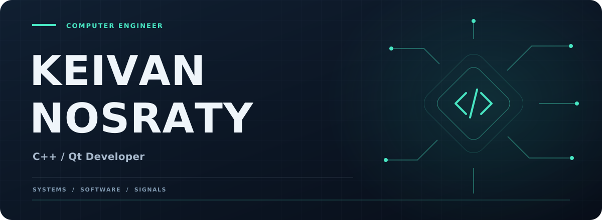

<!-- Keivan Nosraty | GitHub Profile README -->

  

### Computer Engineer | C++ / Qt Developer

---

## About Me

Computer Engineer with a B.Sc. and M.Sc. in **Computer Systems Architecture** from **Isfahan University of Technology**.

My main focus is C++ and Qt, with interests in software architecture, systems programming, RF/ESM, and signal processing.

I enjoy solving complex engineering problems and building efficient, maintainable software.

## Tech Stack

**Languages**

**Frameworks & Tools**

## Interests

- **C++ & Qt:** Desktop applications, QML, and software architecture.
- **Systems & Networking:** Communication frameworks and distributed components.
- **RF & ESM:** Spectrum analysis and electronic support measures.
- **Signal Processing:** Engineering applications and algorithm development.

## Let's Connect

Interested in C++, Qt, systems programming, and challenging engineering projects.

